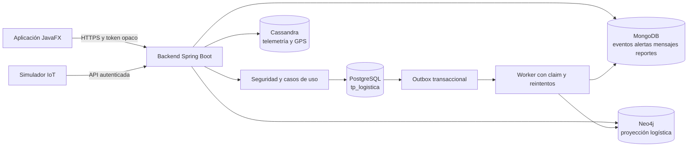

# Arquitectura de la plataforma



El backend es el único componente que conoce credenciales de datos. JavaFX y el simulador consumen contratos `/api/v1`. PostgreSQL conserva la fuente transaccional y financiera; las otras bases reciben datos especializados mediante servicios y consistencia eventual.

## Estructura

```text
.
├── backend/                 Spring Boot, seguridad, servicios y adaptadores
├── desktop/                 aplicación JavaFX FXML/CSS
├── shared-contracts/        records de request y response
├── simulator/               emisor IoT parametrizable
├── database/
│   ├── init/                instalación PostgreSQL local sin datos
│   ├── cassandra/           CQL orientado a consultas
│   ├── neo4j/               constraints e índices UUID
│   └── referencia-postgresql/
├── infra/                   Docker Compose
├── docs/                    auditoría, contratos y matriz
└── evidencias/R01...R40/    resultados reproducibles por requisito
```

## Versiones fijadas

| Componente | Versión | Decisión |
|---|---:|---|
| Java | 21 | LTS requerida |
| Spring Boot | 3.5.8 | línea estable 3.5.x y validación mediante compilación |
| JavaFX | 21.0.8 | línea LTS compatible con Java 21 |
| PostgreSQL | 17.6 | coincide con el objetivo Supabase PostgreSQL 17 |
| MongoDB Java Driver | 5.5.2 | driver síncrono para adaptador explícito |
| Apache Cassandra Java Driver | 4.19.2 | acceso CQL sin escaneo cruzado de repositorios |
| Neo4j Java Driver | 5.28.8 | driver oficial para Cypher parametrizado |
| PDFBox | 3.0.5 | exportación PDF de reportes |
| JUnit | administrado por Boot | pruebas unitarias e integración |
| Testcontainers | administrado por Boot | PostgreSQL y futura validación multistore |

Se eligieron drivers explícitos para Cassandra, MongoDB y Neo4j durante la fundación. Esto evita que varias implementaciones de Spring Data intenten interpretar los mismos modelos. Cada adaptador se habilitará por configuración y tendrá sus modelos de persistencia separados del dominio.

